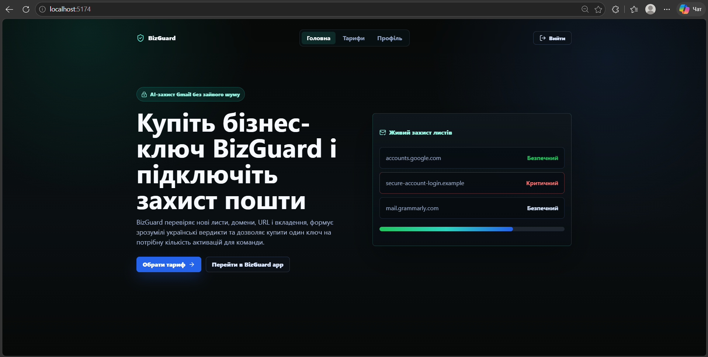
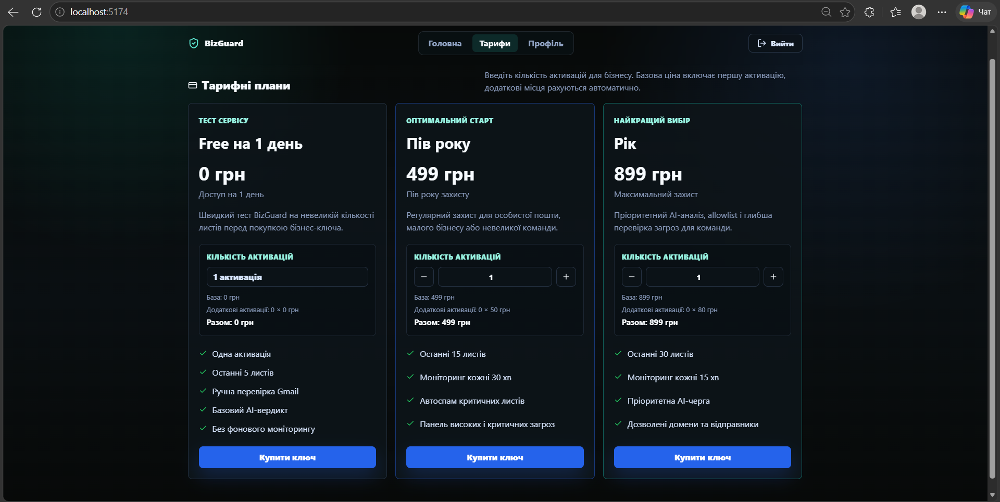
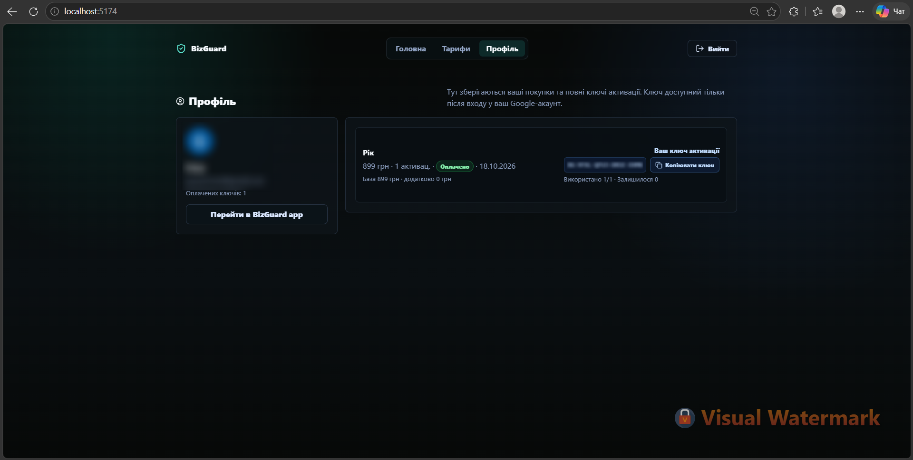
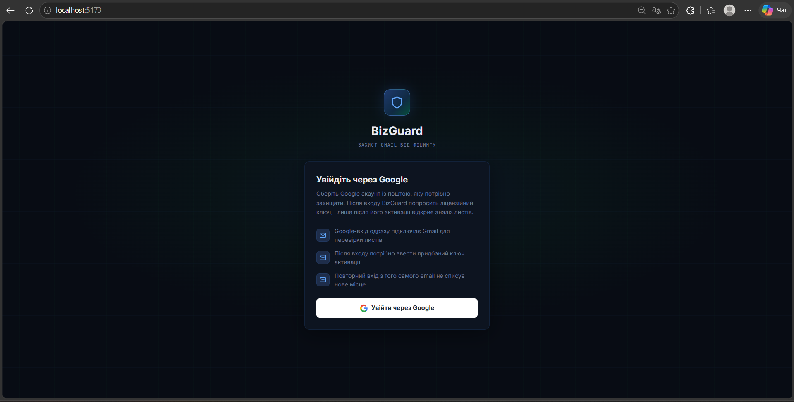
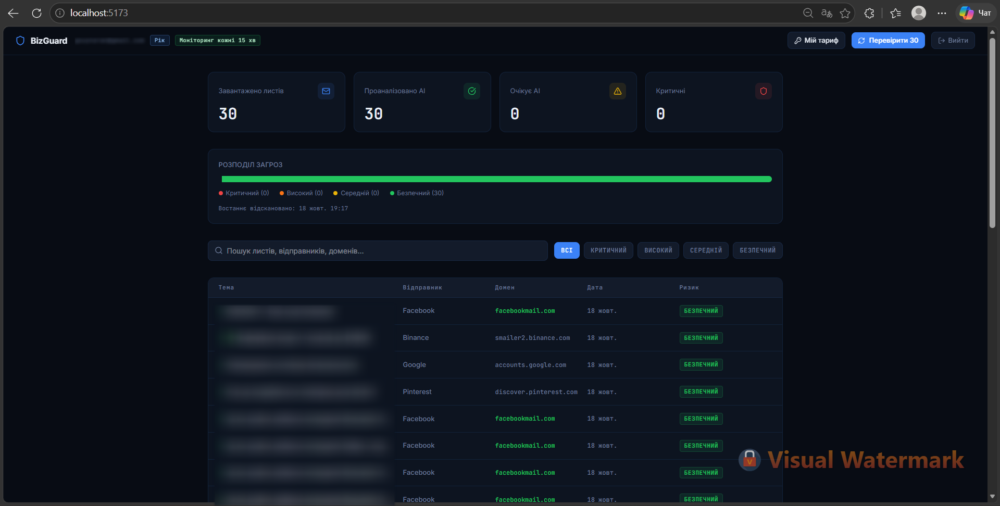
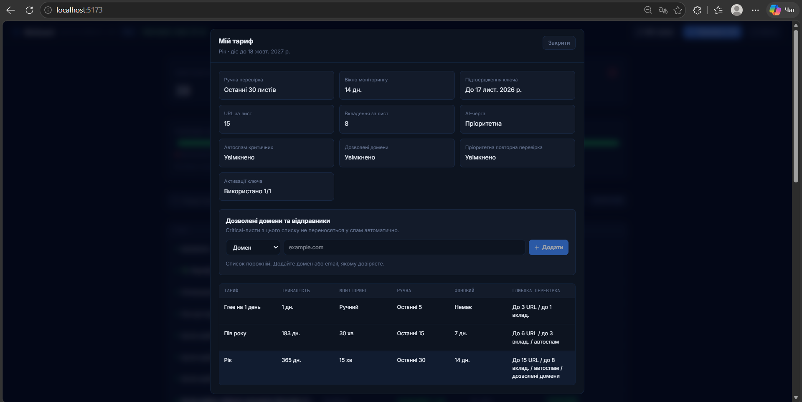
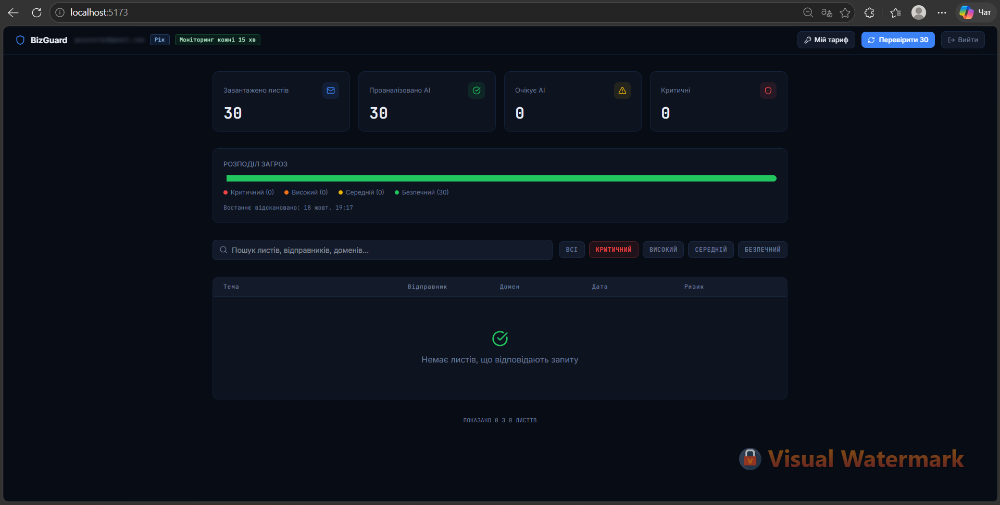
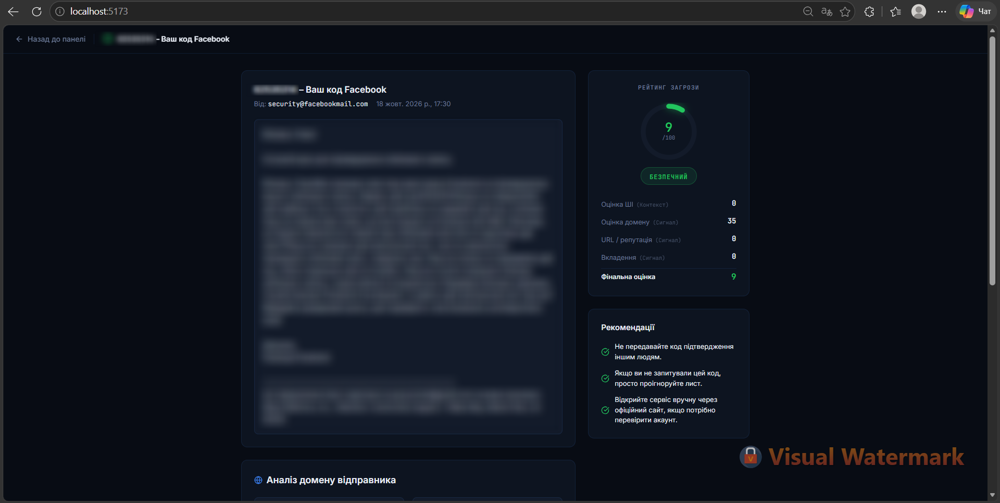
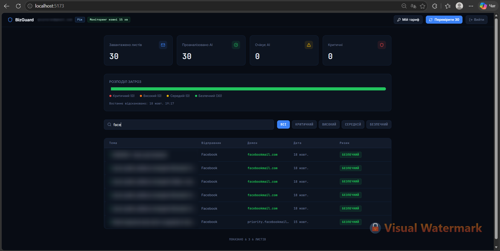
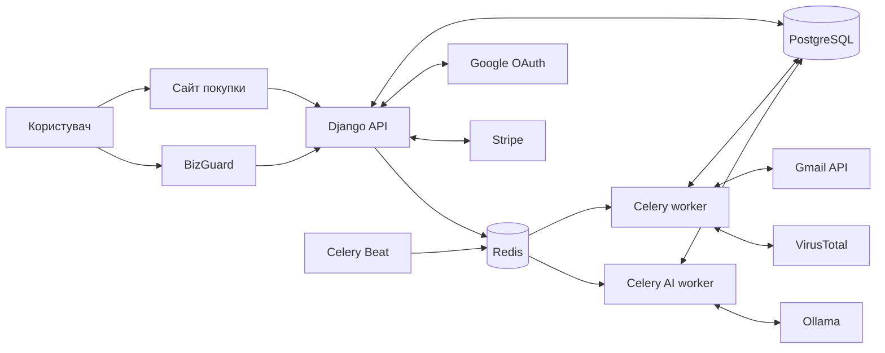

# BizGuard

BizGuard — вебзастосунок для захисту електронної пошти Gmail від фішингу. Він аналізує зміст листів за допомогою локальної AI-моделі, перевіряє відправників, посилання та вкладення і показує зрозумілу оцінку ризику з рекомендаціями.

Репозиторій містить два вебінтерфейси, Django API та сервіси фонового аналізу. Проєкт можна запустити локально через Docker Compose. Конфігурація для розгортання є шаблоном, а не свідченням того, що сервіс уже працює публічно.

## Можливості

- Вхід через Google і підключення Gmail-акаунта.
- Доступ до аналізу після активації ліцензійного ключа.
- Ручна перевірка листів і фоновий моніторинг згідно з тарифом.
- AI-аналіз тексту листа з урахуванням контексту повідомлення.
- Перевірка домену відправника, SPF/DKIM/DMARC, URL та вкладень.
- Інтеграція з VirusTotal для перевірки репутації за наявності API-ключа.
- Оцінка ризику від 0 до 100, пояснення висновку та рекомендації.
- Пошук листів і фільтрація за рівнем ризику.
- Автоматичне переміщення критичних листів у спам на відповідних тарифах.
- Окремий сайт для вибору тарифу, покупки й керування ключами активації.

## Як це працює

1. На сайті покупки користувач входить через Google, вибирає тариф і отримує ключ активації. Повний ключ можна переглянути та скопіювати в профілі покупця.
2. У BizGuard користувач входить до Google-акаунта, пошту якого потрібно захищати, і активує ключ. До активації панель аналізу недоступна.
3. Під час сканування застосунок отримує листи через Gmail API та перевіряє їхній зміст і технічні сигнали.
4. Для AI-аналізу за замовчуванням використовується Ollama з моделлю `qwen2.5:1.5b`. Якщо модель недоступна, аналіз завершується локальними правилами. Деякі явно безпечні листи можуть не потребувати виклику моделі.
5. BizGuard зберігає результат і показує загальний ризик, деталі перевірок та поради щодо подальших дій.

Підсумкова оцінка враховує контекст листа разом із результатами перевірок домену, посилань і вкладень. Окремий сигнал не повинен автоматично перетворювати звичайний лист на фішинговий. Водночас навіть низька оцінка ризику не є гарантією безпеки.

## Скріншоти

### Сайт покупки

Головна сторінка:



Вибір тарифу:



Профіль із придбаним ключем:



### Застосунок BizGuard

Вхід через Google:



Панель аналізу листів:



Інформація про тариф:



Фільтрація за ризиком:



Результат перевірки окремого листа:



Пошук листів:



## Архітектура



| Компонент | Роль |
| --- | --- |
| BizGuard App | React-інтерфейс для входу, активації ключа та аналізу листів. |
| Purchase Site | React-інтерфейс для тарифів, оплати та профілю покупця. |
| Django API | Авторизація, ліцензії, оплата, Gmail і результати перевірок. |
| PostgreSQL | Зберігання користувачів, ліцензій, листів і результатів аналізу. |
| Redis і Celery | Черги синхронізації, AI-аналізу та планового моніторингу. |
| Ollama | Локальна модель для аналізу змісту листів. |
| VirusTotal | Зовнішнє джерело репутації доменів, URL і вкладень. |

`celery_worker` виконує загальні фонові задачі, а `celery_ai_worker` обробляє чергу AI-аналізу. `celery_beat` запускає планові перевірки. Окремого «Llama worker» немає: модель працює в сервісі `ollama`.

### Структура репозиторію

```text
BizGuard/
├── apps/
│   ├── bizguard-app/       # Застосунок для аналізу Gmail
│   └── purchase-site/      # Сайт покупки та профіль
├── backend/
│   ├── apps/
│   │   ├── accounts/       # Google OAuth
│   │   ├── billing/        # Покупки та оплата
│   │   ├── licenses/       # Тарифи й активація ключів
│   │   ├── gmail/          # Синхронізація та аналіз листів
│   │   └── reputation/     # Репутація доменів і URL
│   └── config/             # Налаштування Django та Celery
├── screenshots/            # Знімки інтерфейсу
├── docker-compose.yml      # Локальне середовище
└── docker-compose.prod.yml # Шаблон для розгортання
```

## Тарифи

| Тариф | Строк | Ручна перевірка | Фоновий моніторинг |
| --- | --- | --- | --- |
| Free на 1 день | 1 день | Останні 5 листів | Немає |
| Пів року | 183 дні | Останні 15 листів | Кожні 30 хвилин |
| Рік | 365 днів | Останні 30 листів | Кожні 15 хвилин |

Платні тарифи підтримують автоматичні дії для критичних листів. Річний тариф також надає пріоритет у черзі AI-аналізу та список дозволених доменів і відправників. Кількість активацій для платного ключа вибирають під час покупки. Актуальні ціни та повні умови показує сайт покупки; джерело налаштувань тарифів у коді — `backend/apps/licenses/services.py`.

## Локальний запуск

Потрібні Docker Desktop із Docker Compose та налаштований OAuth-клієнт Google. Команди нижче виконуються з кореня репозиторію в PowerShell.

1. Створіть локальний файл налаштувань:

   ```powershell
   Copy-Item backend/.env.example backend/.env
   ```

2. У `backend/.env` задайте власні `GOOGLE_OAUTH_CLIENT_ID`, `GOOGLE_OAUTH_CLIENT_SECRET`, `DJANGO_SECRET_KEY`, `LICENSE_KEY_HASH_SECRET` і `BILLING_LICENSE_ENCRYPTION_SECRET`.
3. Для OAuth-клієнта Google зареєструйте адреси перенаправлення з `backend/.env.example`: `http://localhost:5173/auth/callback` для BizGuard і `http://localhost:8000/api/accounts/google/public-redirect` для сайту покупки. Якщо зміните хост або порт, оновіть адреси і в Google, і в конфігурації.
4. Запустіть сервіси та застосуйте міграції:

   ```powershell
   docker compose up -d --build
   docker compose exec backend python manage.py migrate
   ```

5. Відкрийте [BizGuard](http://localhost:5173) і [сайт покупки](http://localhost:5174). Локальний API працює на `http://localhost:8000`; за ввімкненого `API_DOCS_ENABLED` його документація доступна на `http://localhost:8000/api/docs/`.

Під час першого запуску сервіс `ollama_pull` завантажує модель. Перевірити стан можна так:

```powershell
docker compose ps -a ollama ollama_pull celery_ai_worker
docker compose exec ollama ollama list
```

Якщо модель не з’явилася, запустіть `docker compose run --rm ollama_pull`. Поки Ollama недоступна, BizGuard використовує локальний резервний аналіз.

## Налаштування інтеграцій

| Змінна | Призначення |
| --- | --- |
| `GOOGLE_OAUTH_CLIENT_ID`, `GOOGLE_OAUTH_CLIENT_SECRET` | Google-вхід і доступ до Gmail. |
| `GOOGLE_OAUTH_REDIRECT_URI`, `GOOGLE_PUBLIC_OAUTH_REDIRECT_URI` | Адреси повернення після входу в застосунок і на сайт покупки. |
| `OLLAMA_BASE_URL`, `OLLAMA_MODEL` | Адреса локальної моделі та її назва. |
| `VIRUSTOTAL_API_KEY` | Додаткова перевірка репутації через VirusTotal. |
| `STRIPE_SECRET_KEY` | Оплата платних тарифів через Stripe. |
| `BILLING_FAKE_MODE` | Тестовий режим покупок без реальної оплати. |
| `LICENSE_KEY_HASH_SECRET`, `BILLING_LICENSE_ENCRYPTION_SECRET` | Окремі секрети для ліцензій і зберігання ключів покупок. |
| `DATABASE_URL`, `REDIS_URL` | PostgreSQL і Redis; локальний Compose задає їх самостійно. |

VirusTotal необов’язковий: без API-ключа зовнішня перевірка недоступна, але локальні сигнали й аналіз листа продовжують працювати. Для тестування платних покупок без Stripe задайте `BILLING_FAKE_MODE=True` у кореневому локальному `.env` або змінній середовища перед запуском Docker Compose. Значення цієї змінної з `backend/.env` перекривається налаштуванням Compose. Не використовуйте тестовий режим для реальних оплат.

## API та перевірки

Основні групи API: `/api/accounts/`, `/api/licenses/`, `/api/billing/`, `/api/gmail/` і `/api/reputation/`. Частина маршрутів потребує входу та активної ліцензії.

Перевірити сервер, виконати тести й зібрати обидва інтерфейси:

```powershell
docker compose exec -T backend python manage.py check
docker compose exec -T backend python manage.py test --keepdb --noinput
npm --prefix apps/bizguard-app ci
npm --prefix apps/purchase-site ci
npm --prefix apps/bizguard-app run build
npm --prefix apps/purchase-site run build
docker compose config --quiet
```

## Розгортання

`docker-compose.prod.yml` і `.env.production.example` — шаблони для власного середовища, а не готовий публічний деплой. Production-конфігурація збирає фронтенди, запускає Django через Gunicorn та віддає вебінтерфейси через Nginx. Перед публікацією потрібно задати власні секрети й домени, налаштувати HTTPS, доступ до бази даних, резервні копії та дозволені Google OAuth-адреси.

Перевірка шаблону без запуску:

```powershell
docker compose --env-file .env.production.example -f docker-compose.prod.yml config --quiet
```

Не додавайте до Git файли `.env`, ключі API, OAuth-токени та збережені листи.

## Обмеження та конфіденційність

- BizGuard працює лише з підключеним Gmail-акаунтом. Це не антивірус для пристрою.
- AI і репутаційні сервіси можуть помилятися; підозрілі листи слід оцінювати з урахуванням їхнього контексту.
- Сайт покупки запитує базові дані Google-профілю. Для аналізу пошти BizGuard запитує дозвіл `gmail.modify`, потрібний також для переміщення критичних листів у спам.
- Ollama працює в локальному сервісі. Якщо ввімкнено VirusTotal, йому передаються дані для перевірки доменів і URL; невідомі вкладення можуть бути завантажені до VirusTotal. Враховуйте це перед підключенням конфіденційної пошти.

## Типові проблеми

- **Google повідомляє `redirect_uri_mismatch`:** перевірте точний збіг адрес у Google Cloud і `backend/.env`.
- **Ключ не відкриває панель:** перевірте Google-акаунт, строк ліцензії, кількість активацій і статус покупки.
- **Листи очікують AI-аналізу:** перевірте `redis`, `celery_ai_worker`, `ollama` та наявність моделі.
- **Нові листи не з’являються:** перевірте дозвіл Gmail, активність ліцензії та запустіть сканування повторно.
- **VirusTotal недоступний:** перевірте API-ключ і ліміти сервісу. Відсутність відповіді не означає, що посилання чи файл безпечні.

## Ліцензія

У репозиторії наразі немає файлу `LICENSE`. Перед відкритим розповсюдженням проєкту потрібно визначити умови його використання.
